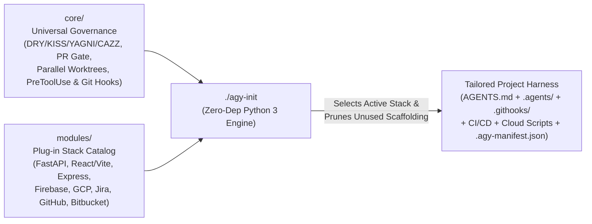

# `agy_template` — Modular Antigravity Starter & Engineering Governance Harness

> **Start every new project with the AI Engineering Manager workflow—without carrying a single line of unused skills, hooks, or CI boilerplate.**

`agy_template` extracts the battle-tested Antigravity governance system evolved across 180+ commits and 100+ Pull Requests (concise `AGENTS.md` routing, lazy-loaded skills, multi-agent `pr-quality-gate`, parallel git worktree `parallel-pr-orchestrator`, `product-strategy-gate`, deterministic lifecycle hooks, and cloud/git automation) into a **plug-and-play template**.

Fork or use this template, pick your stack once—via CLI or by asking Antigravity in plain language—and `./agy-init` **programmatically prunes** every irrelevant skill, hook, script, and pipeline, leaving a lean, zero-bloat governance harness ready for Day-1 feature development.

---

## Architecture



---

## 2-Minute Quick Start

1. Click **Use this template** (or fork) on GitHub and clone your new repository.
2. Initialize your stack using **Option A (Ask Antigravity)** or **Option B (CLI)**:

### Option A — Ask Antigravity AI

Open the cloned repository in Antigravity and tell the agent your stack:

> *"Configure this repository for a Python FastAPI, Firebase, Google Cloud, Jira (project key ORD), and Bitbucket project named Order API, and clean up unused template automations."*

Antigravity detects the uninitialized workspace via `.agents/hooks.json` (`SessionStart`), loads `.agents/skills/template-initializer/SKILL.md`, inspects `./agy-init --list-modules --json`, and runs `./agy-init` programmatically.

### Option B — Run `./agy-init` Directly

Run interactively in your terminal:
```sh
./agy-init
```

Or non-interactively with explicit flags:

```sh
# Example 1: Python FastAPI + Firebase + GCP Cloud Run + Jira + Bitbucket
./agy-init \
  --project-name "Order API" \
  --frontend none \
  --backend python-fastapi \
  --data firebase \
  --cloud gcp-cloudrun \
  --issue-tracker jira \
  --jira-key ORD \
  --git-hosting bitbucket \
  --yes

# Example 2: React/Vite + Node/Express + Firebase + GCP Cloud Run + GitHub
./agy-init \
  --project-name "Studio App" \
  --frontend react-vite-ts \
  --backend node-express-ts \
  --data firebase \
  --cloud gcp-cloudrun \
  --issue-tracker github-issues \
  --git-hosting github \
  --yes
```

---

## What Remains After Initialization

- **`AGENTS.md` & `.agents/stack-profile.md`**: A concise AI router (< 2 KB) plus your active stack's verification commands, domain evaluators, concurrency locks, and branch/ticket conventions.
- **`.agents/skills/`**: Only the universal engineering skills (`engineering-philosophy`, `pr-quality-gate`, `parallel-pr-orchestrator`, `product-strategy-gate`) **plus** the skills for your selected modules.
- **`.agents/hooks.json` + `.agents/hooks/pre_tool_guard.py`**: Deterministic Antigravity `PreToolUse` guards blocking committed `file:///` Markdown links, guarding live `.env` files, and requiring explicit confirmation for destructive git, PR merge, and production deploy commands.
- **`.githooks/`**: Pre-configured `pre-commit`, `commit-msg`, and `pre-push` hooks (`core.hooksPath = .githooks`) enforcing branch safety, secret protection, Markdown hygiene, Conventional Commits / Jira key checks, and modular language linters.
- **CI/CD, PR Templates & Cloud Scripts**: Dynamically generated `.github/workflows/ci.yml` + Dependabot **or** `bitbucket-pipelines.yml` + `.bitbucket/pull_request_template.md`, plus idempotent `scripts/provision.sh` and `scripts/deploy.sh` when Cloud Run is selected.
- **Zero Template Bloat**: `modules/`, `core/`, `tests/`, `CONTRIBUTING_MODULES.md`, `scripts/agy_init.py`, and `agy-init` are removed automatically.

---

## Built-In Module Catalog (v1)

| Category | Module ID | Description |
| :--- | :--- | :--- |
| **Frontend** | `react-vite-ts` | React, Vite, TypeScript, `modern-web-guidance` a11y/mobile checks, Vitest |
| **Backend** | `python-fastapi` | Python 3.12+, FastAPI, Pydantic v2, virtualenv guard, Ruff + mypy + pytest |
| **Backend** | `node-express-ts` | Node.js, Express, TypeScript, Bearer/Cron auth middleware, Vitest |
| **Data & BaaS** | `firebase` | Firebase Auth, named Firestore DB, `firestore.rules` baseline & emulator mutex |
| **Cloud & Deployment** | `gcp-cloudrun` | Cloud Run `provision.sh` & `deploy.sh`, Secret Manager, Sandbox/Prod parity |
| **Issue Tracker** | `github-issues` | GitHub Issues & Milestones (`gh`), skeptical deduplication, `Closes #<id>` |
| **Issue Tracker** | `jira` | Atlassian Jira (`PROJ-<num>`), JQL deduplication, `commit-msg` ticket gate |
| **Git Hosting & CI/CD** | `github` | GitHub Actions CI generator, PR template, Dependabot, `gh pr` stacked merges |
| **Git Hosting & CI/CD** | `bitbucket` | Bitbucket Pipelines YAML generator, PR template, `bkt` / REST v2 stacked merges |

---

## Adding New Modules (Open/Closed Architecture)

Want to add `java-spring`, `gitlab`, `linear`, or `aws-ecs`? Modules are auto-discovered from `modules/<category>/<module-id>/module.json`—**no edits to `scripts/agy_init.py` are required**.

See [`CONTRIBUTING_MODULES.md`](CONTRIBUTING_MODULES.md) for the schema, `render.py` contract, and validation suite.
