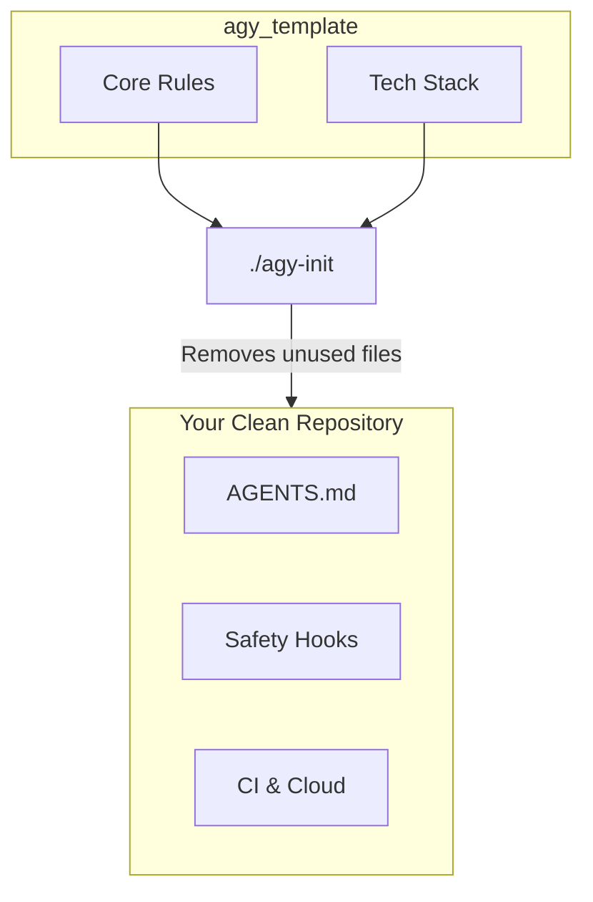

# `agy_template`

A modular starter template for building software with **Google Antigravity**.

AI coding assistants slow down and make mistakes when a repository is filled with rules and skills for tools you do not use. `agy_template` fixes that: you pick your tech stack once, and a small setup script deletes every unused skill, hook, script, and pipeline—leaving a clean workspace tailored to your project.

---

## How It Works



---

## Quick Start

1. Click **Use this template** (or fork) on GitHub and clone your new repository.
2. Choose your stack using either **Antigravity** or the **CLI**:

### Option A — Ask Antigravity

Open the cloned folder in Antigravity and tell it what you are building:

> *"Set up this repo for a Python FastAPI, Firebase, Google Cloud, Jira (key ORD), and Bitbucket project named Order API, and remove everything else."*

Antigravity reads the available modules and runs `./agy-init` for you.

### Option B — Run `./agy-init`

Run the interactive wizard:
```sh
./agy-init
```

Or pass your stack as flags:

```sh
# Python FastAPI + Firebase + GCP Cloud Run + Jira + Bitbucket
./agy-init \
  --project-name "Order API" \
  --frontend none \
  --backend python-fastapi \
  --data firebase \
  --cloud gcp-cloudrun \
  --issue-tracker jira \
  --jira-key ORD \
  --git-hosting bitbucket \
  --yes

# React/Vite + Node/Express + Firebase + GCP Cloud Run + GitHub
./agy-init \
  --project-name "Studio App" \
  --frontend react-vite-ts \
  --backend node-express-ts \
  --data firebase \
  --cloud gcp-cloudrun \
  --issue-tracker github-issues \
  --git-hosting github \
  --yes
```

---

## What Gets Configured

- **AI Rules & PR Reviews:** A short `AGENTS.md` router, `.agents/stack-profile.md` with your test commands, shared engineering rules (**DRY**, **KISS**, **YAGNI**, **CAZZ**), multi-agent PR review gates, parallel worktree orchestration, and only the skills for your chosen stack.
- **Safety Hooks:** Antigravity `PreToolUse` checks and Git hooks (`.githooks/`) that block secrets (`.env`), prevent broken local `file:///` links in Markdown, check commit formats, and gate merges or production deploys.
- **CI/CD & PR Templates:** Ready-to-run `.github/workflows/ci.yml` + Dependabot or `bitbucket-pipelines.yml` + `.bitbucket/pull_request_template.md`.
- **Cloud Scripts:** Idempotent `scripts/provision.sh` and `scripts/deploy.sh` with Secret Manager and Sandbox/Production parity when Cloud Run is selected.

Once finished, `agy-init`, `core/`, `modules/`, and `tests/` are deleted automatically so zero template clutter remains.

---

## Available Modules

| Category | Module ID | What It Covers |
| :--- | :--- | :--- |
| **Frontend** | `react-vite-ts` | React, Vite, TypeScript, accessibility/mobile checks, Vitest |
| **Backend** | `python-fastapi` | Python 3.12+, FastAPI, Pydantic v2, virtualenv guard, Ruff, mypy, pytest |
| **Backend** | `node-express-ts` | Node.js, Express, TypeScript, auth middleware, Vitest |
| **Data & BaaS** | `firebase` | Firebase Auth, named Firestore DB, `firestore.rules` baseline, emulator rules |
| **Cloud** | `gcp-cloudrun` | Cloud Run `provision.sh` & `deploy.sh`, Secret Manager, Sandbox/Prod parity |
| **Issue Tracker** | `github-issues` | GitHub Issues & Milestones via `gh` CLI |
| **Issue Tracker** | `jira` | Atlassian Jira (`PROJ-<num>`), JQL checks, commit key enforcement |
| **Git Hosting** | `github` | GitHub Actions CI, PR template, Dependabot, `gh pr` workflow |
| **Git Hosting** | `bitbucket` | Bitbucket Pipelines, PR template, `bkt` / REST API workflow |

---

## Adding New Modules

Want to contribute `java-spring`, `gitlab`, `linear`, or another tool? Each module lives in its own folder under `modules/<category>/<module-id>/` and is picked up automatically—no changes to `scripts/agy_init.py` needed.

See [`CONTRIBUTING_MODULES.md`](CONTRIBUTING_MODULES.md) for the folder layout, schema, and tests.
