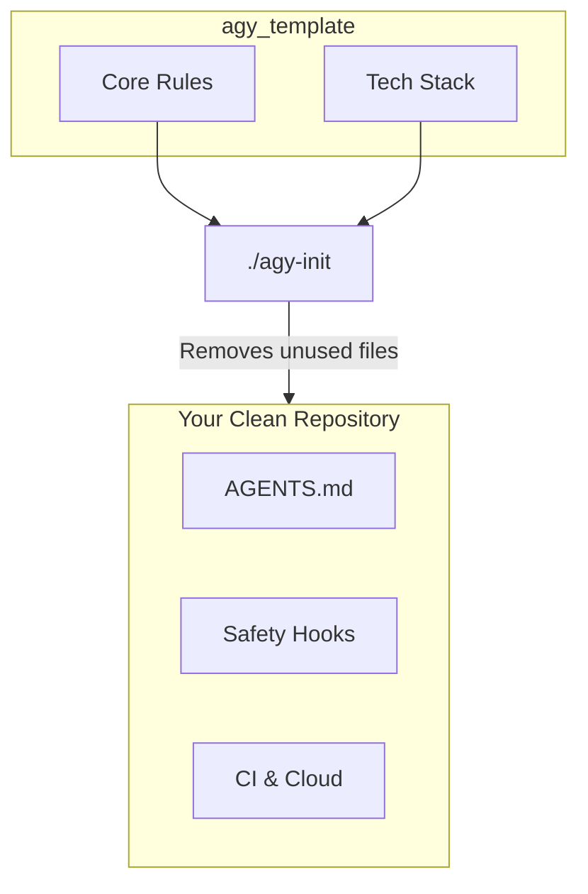

# `agy_template`

> A modular starter template for building software with **Google Antigravity**—without carrying rules for tools you don't use.

AI coding assistants slow down and make mistakes when a repository is stuffed with instructions for the wrong stack. `agy_template` flips that around: pick your tools once, and a zero-dependency Python 3 script deletes every unused skill, hook, script, and pipeline—leaving a lean workspace tailored to your project.

---

## How It Works



---

## Quick Start

1. Click **Use this template** on GitHub and clone your new repository.
2. Pick your stack with **Antigravity** or from your terminal:

### Option A — Ask Antigravity

Open the cloned folder in Antigravity and tell it what you are building:

> *"Set up this repo for a Python FastAPI, Firebase, Google Cloud, Jira (key ORD), and Bitbucket project named Order API, and remove everything else."*

Antigravity reads the module catalog and runs `./agy-init` for you.

### Option B — Run `./agy-init`

Launch the interactive wizard:

```sh
./agy-init
```

`agy-init` always targets your **current working directory** by default (or pass `--output-dir <path>`). Running `/path/to/agy_template/agy-init` from inside another repository initializes that repository in-place without modifying the `agy_template` source repo.

Want to see what will be created and removed before touching disk? Add `--dry-run`. You can also list options with `./agy-init --list-modules`, or pass flags directly:

```sh
./agy-init \
  --project-name "Studio App" \
  --frontend react-vite-ts \
  --backend node-express-ts \
  --data firebase \
  --cloud gcp-cloudrun \
  --issue-tracker github-issues \
  --git-hosting github \
  --yes
```

<details>
<summary>More examples: Go + PostgreSQL + Linear + GitLab, or Python FastAPI + Firebase + Cloud Run + Jira + Bitbucket</summary>

```sh
./agy-init \
  --project-name "Billing Service" \
  --frontend none \
  --backend go-service \
  --data postgres \
  --cloud none \
  --issue-tracker linear \
  --param LINEAR_TEAM_KEY=ENG \
  --git-hosting gitlab \
  --yes
```

```sh
./agy-init \
  --project-name "Order API" \
  --frontend none \
  --backend python-fastapi \
  --data firebase \
  --cloud gcp-cloudrun \
  --issue-tracker jira \
  --jira-key ORD \
  --git-hosting bitbucket \
  --yes
```

</details>

---

## What You End Up With

- **Focused AI Rules:** A short `AGENTS.md` router, `.agents/stack-profile.md` with your test commands, shared engineering principles (**DRY**, **KISS**, **YAGNI**, **CAZZ**), multi-agent PR review gates, parallel worktree orchestration, and only the skills your stack needs.
- **Safety Hooks:** Antigravity `PreToolUse` checks and Git hooks (`.githooks/`) that block committed `.env` secrets, catch broken `file:///` links in Markdown, validate commit formats, and gate merges, destructive database actions, or production deploys.
- **CI/CD & PR/MR Templates:** Ready-to-run `.github/workflows/ci.yml` + Dependabot, `bitbucket-pipelines.yml` + `.bitbucket/pull_request_template.md`, or `.gitlab-ci.yml` + `.gitlab/merge_request_templates/Default.md`.
- **Cloud Scripts:** Idempotent `scripts/provision.sh` and `scripts/deploy.sh` with Secret Manager and Sandbox/Production parity when Cloud Run is selected.

When initializing an `agy_template` clone in-place, `agy-init`, `core/`, `modules/`, and `tests/` remove themselves automatically—no leftover template scaffolding. When targeting an existing repository, existing `README.md` and `docs/` files are preserved, `.gitignore` and `.env.example` lines are merged without duplicates, and re-running `./agy-init` reads `.agy-manifest.json` to add/switch modules and prune stale harness files.

---

## Available Modules

Mix and match across **17 modules in 6 categories** (multi-select allowed for **Data & BaaS**; pass `none` for optional categories):

| Category | Module ID | What It Covers |
| :--- | :--- | :--- |
| **Frontend** | `react-vite-ts` | React, Vite, TypeScript, accessibility & mobile checks, Vitest |
| **Frontend** | `nextjs-ts` | Next.js App Router, React Server Components, TypeScript, accessibility & Core Web Vitals |
| **Backend** | `python-fastapi` | Python 3.12+, FastAPI, Pydantic v2, virtualenv guard, Ruff, mypy, pytest |
| **Backend** | `node-express-ts` | Node.js, Express, TypeScript, auth middleware, Vitest |
| **Backend** | `go-service` | Go 1.22+ HTTP/gRPC services, `context.Context` & `%w` wrapping, `go vet`, `golangci-lint`, `go test -race` |
| **Backend** | `java-spring` | Java 21+, Spring Boot 3, constructor injection, `@Valid` DTOs, Maven/Gradle (`./mvnw test` / `./gradlew test`) |
| **Data & BaaS** | `firebase` | Firebase Auth, named Firestore DB, `firestore.rules` baseline, emulator rules |
| **Data & BaaS** | `postgres` | PostgreSQL schema design, parameterized queries, zero-downtime migrations, pooling, destructive SQL guards |
| **Data & BaaS** | `supabase` | Supabase Auth, PostgreSQL RLS policies, migrations, `supabase start` / `db reset` / `test db` |
| **Data & BaaS** | `alloydb` | Google Cloud AlloyDB, Auth Proxy / language connectors, IAM auth, `pgvector` & columnar engine |
| **Cloud** | `gcp-cloudrun` | Cloud Run `provision.sh` & `deploy.sh`, Secret Manager, Sandbox/Prod parity |
| **Issue Tracker** | `github-issues` | GitHub Issues & Milestones via `gh` CLI |
| **Issue Tracker** | `jira` | Atlassian Jira (`PROJ-<num>`), JQL checks, commit key enforcement |
| **Issue Tracker** | `linear` | Linear (`TEAM-<num>`), cycles/projects, MCP config, commit key enforcement |
| **Git Hosting** | `github` | GitHub Actions CI, PR template, Dependabot, `gh pr` workflow |
| **Git Hosting** | `bitbucket` | Bitbucket Pipelines, PR template, `bkt` / REST API workflow |
| **Git Hosting** | `gitlab` | GitLab CI/CD (`.gitlab-ci.yml`), MR template, `glab mr` workflow & merge gate |

---

## Adding Your Own Modules

Want to add `rust-axum`, `aws-ecs`, `azure-devops`, or another tool? Drop a folder under `modules/<category>/<module-id>/` and it is discovered automatically—no edits to `scripts/agy_init.py` required.

See [`CONTRIBUTING_MODULES.md`](CONTRIBUTING_MODULES.md) for the folder layout, schema, and tests. Licensed under the [MIT License](LICENSE).
